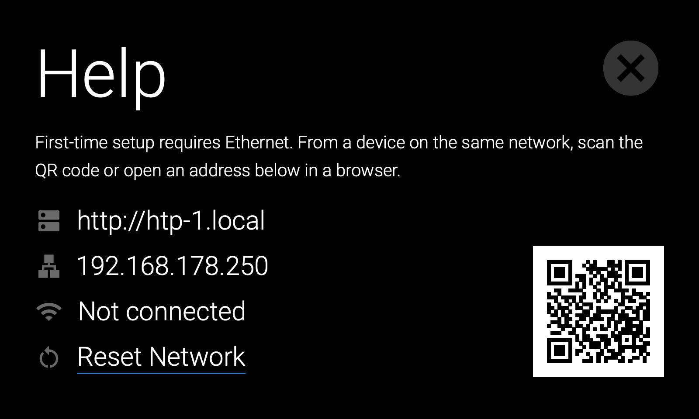

# Basic Setup

!!! note "Check your software version early"
    The HTP-1's software is still actively developed, and updates are installed by owners rather
    than pushed automatically. Units in the field run a wide range of builds, and a unit that has
    been sitting in a box — or in a rack — may be several years behind. Much of what this manual
    describes, and several fixes to problems you might otherwise spend an evening chasing, only
    exist in recent software.

    If you are setting up an HTP-1 for the first time, plan on updating it. You can do that once
    the unit is on the network and you can reach its web interface — see
    [Update the Firmware](#update-the-firmware) below and
    [Updates and Support](maintenance.md). For background on why the software keeps moving, see
    [The Nature of the Project](project.md).

## System Requirements

1. AC power
2. Ethernet connection (initially wired, then Wi-Fi if desired)
3. Audio and video sources
4. Connection to an amplifier
5. A modern web browser, preferably on a device larger than a phone.

## Step by Step

The best way to become familiar with the HTP-1 is to simply start using it! Before delving into more advanced topics, we will connect one HDMI® source, an HDMI display, and a power amplifier in stereo 2.0.0 mode. Perform the following steps to connect these devices. The internal signal generator can also be used as a test source with no external source.

1. Prepare a location for the HTP-1. Ensure that it is not in an enclosed cabinet, that it has at least 3" of space around and above the unit, and that it is in a well-ventilated area to ensure sufficient cooling airflow. The HTP-1 can operate entirely from a Wi-Fi link, but it is best to connect to a wired Ethernet first and use that connection to configure the Wi-Fi network. If your final location does not include a wired Ethernet cable, then see the note below on [Initial Wi-Fi Setup](#initial-wi-fi-setup).
2. Ensure that all equipment to be connected is powered off and unplugged from its power source.
3. Connect the included Bluetooth®/Wi-Fi® Antenna to the antenna jack on the rear panel.
4. Using a Cat5e or Cat6 Ethernet cable (not included), plug one end into the ETHERNET jack on the rear panel, then plug the other end into your Wi-Fi® router or Ethernet switch.

    !!! note
        Version 2.2.0 restores gigabit Ethernet operation. For connection problems and older-software
        workarounds, see [Network → Ethernet](network.md#ethernet).

5. Using an HDMI Cable (not included), plug one end into the input on your HDMI® display, then plug the other end into HDMI OUTPUT 1 on the rear panel. A "Premium High Speed" HDMI cable is specified for UHD/4K operation.

    !!! note
        HDMI OUTPUT 1 supports the Audio Return Channel (ARC) and Enhanced Audio Return Channel (eARC) HDMI features, which send audio from the connected display back to the amplifier. The ARC/eARC feature is necessary if you plan on streaming video from the internet using an application on your TV or if you plan on receiving over-the-air TV broadcasts using an HD antenna connected to the TV. You must connect the TV to output 1 for (e)ARC to work.

6. Using suitable speaker cable (not included), connect your speakers to the corresponding outputs on your power amplifier. A **2.5 mm² (approximately 13–14 AWG) stranded copper speaker cable** is sufficient for most home theater installations and cable runs up to about **10 m (33 ft)**. For longer runs, **4 mm² (approximately 11 AWG)** cable is recommended. Ensure that there are no stray wire strands that could cause a short circuit, and maintain correct polarity (**+** to **+**, **−** to **−**) for all speaker connections.
7. If your power amplifier has XLR inputs, plug an XLR cable (not included) into the left channel input on your power amplifier, then plug the other end into the LEFT MAIN OUTPUT on the rear panel. If your power amplifier only has RCA inputs, use an XLR to RCA cable (not included) instead. Repeat for the right channel.
8. Using another (Premium High Speed) HDMI® Cable (not included), plug one end into HDMI INPUT 1 on the rear panel, then plug the other end into the HDMI output on a video source device (e.g., DVD player, Blu-ray Disc™ player, satellite receiver, cable box, etc.).
9. Ensure that the Master Power Switch on the rear panel is in the OFF position (O side depressed).
10. Plug the included AC Power Cord into the C14 power connector on the rear panel, then plug the other end into a nearby AC power outlet.
11. Plug in and power on all connected devices. Start video playback on your video source device.
12. Flip the Master Power Switch on the rear panel to the ON position (I side depressed) to boot the system. You should see the Monolith logo displayed on the front panel within seconds after pressing the power switch. The front panel power switch should begin flashing blue. Startup normally takes about a minute. During startup, the front panel may show **Almost ready** or **Preparing Dirac Live filters** before the main screen appears, and the web interface shows **HTP-1 is starting** with the current step, such as **Preparing Dirac Live filters**. The first startup after updating can take several minutes while missing Dirac Live filter versions are prepared. Once the unit has finished booting, the Front Panel LCD Display will look similar to the display in the [Product Overview](product-overview.md) section. The blue light on the front panel power switch goes dark again when the unit is ready.
13. For normal operation, use the Power/Standby Button on the front panel to turn the unit on or put it into standby, rather than using the Master Power Switch on the rear panel.

    **Fast Start** controls startup time and standby power consumption. See [Device Settings → Power](device-settings.md#power) for the differences between the two standby modes and how to enable Fast Start.

14. On first startup, the front panel provides the information needed to access the HTP-1's web interface from another device on the same network. Open the **Help** screen by tapping the **?** icon in the top right. It shows the HTP-1's mDNS hostname, network addresses, and a QR code.

    

15. Open a web browser on your computer or other device on the same network. The easiest address to use is usually the mDNS hostname shown on the front panel, such as `http://htp-1.local`. You can also use the displayed IP address.

    Make sure to include `http://` explicitly, as some browsers default to `https://`, which will not work. You can also scan the displayed QR code with your mobile phone to open the web interface directly.

    Bookmark the main address, such as `http://htp-1.local/`, rather than an individual settings page. Use the web interface’s navigation to open settings.

16. If your source connected to HDMI 1 is playing, you should see the front panel and the Home page describe the program format and the listening format. The front panel should display -50dB as the default initial volume.

17. Slowly turn the Volume Knob on the front panel clockwise until the volume is at a comfortable level. Verify that both the left and right audio channels are playing audio properly and that there is video on your display.

    Congratulations! You have finished the Basic Setup and are ready to learn more about the advanced features and functionality of the HTP-1.

    

18. Click the **gear** icon (labeled **Settings**) in the top-left corner of the Home page. This opens the settings sidebar. Explore the **Speakers** page and the **Signal Generator** page — see [Product Overview](product-overview.md#web-interface) for the full page list.

## Initial Wi-Fi Setup

The HTP-1 serves a web page via its Ethernet connection and this is used for all setup. You must connect to a network. If you wish to use a Wi-Fi connection exclusively, begin by booting up the HTP-1 with a wired connection. You can set up the Wi-Fi connection, disconnect the Ethernet cable and then move the HTP-1 to its final location.

The [Network](network.md#wi-fi) chapter gives further information on Wi-Fi, in the context of the **Network** page.

1. Connect the included Bluetooth®/Wi-Fi® Antenna to the antenna jack on the rear panel.
2. Connect an Ethernet cable to the HTP-1 so that your router can assign an IP address.
3. Following the boot steps above, boot up the HTP-1 and open its web interface.
4. Click the **gear** icon in the top-left corner of the Home page to open settings, then choose **Network** from the sidebar (setup group). There will be a short delay as the network system is prepared. You should see your wired Ethernet connection described under **Current Settings**.
5. Scroll down to the **Wi-Fi** section. Turn Wi-Fi on, and confirm DHCP is enabled. Under **Manage Wi-Fi Networks** you should see your local Wi-Fi networks listed.
6. Choose a network (an SSID). Enter the password — there is an option to show it as you type. Click **Configure Network**. After a brief delay, the network appears in the list of configured networks and is described as connected. The front panel of the HTP-1 should display the Wi-Fi address on the **Help** screen after tapping the **?** icon in the top right. (The **Connect**, **Disconnect** and **Forget** buttons in the configured-network list are used afterward, to manage a Wi-Fi network you have already set up.)
7. You can now remove the wired Ethernet connection. If necessary you can move the HTP-1 to its final location and continue with the audio and video connections.

## Update the Firmware

After completing basic setup, open **System Status** and click **Check for updates**. Select
**Version history** to browse releases and read their release notes. See
[Updates and Support](maintenance.md) for installation instructions.

## Interface Description

If you followed the Basic Connections instructions above you should be ready to use some of the more advanced features. Click the **gear** icon in the top-left corner of the Home page to open the settings sidebar. See [Product Overview → Web Interface](product-overview.md#web-interface) for the full map of the sidebar's three groups and what each page does.

!!! tip
    The circled question mark in the top-right corner of most pages opens page-specific help.
