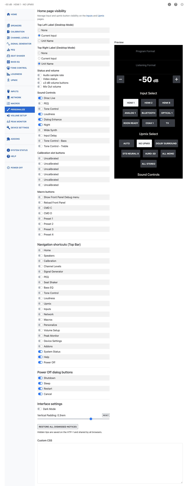

# Personalize

The Personalize page controls what appears on the [Home Page](home-page.md), what shortcuts
you see throughout the web UI, and a few display preferences for the interface as a whole.
A live preview of the Home page sits alongside the settings, so you can see the effect of a
change immediately.

## Home Page Visibility

Under **Top Left Label** and **Top Right Label** (desktop mode), choose what appears in the
corners of the Home page: **None**, **Current Input**, or **Unit Name**.

Under **Status and volume**, use these switches to choose additional Home page displays and volume
buttons:

| Switch | Effect |
|---|---|
| Video status | Adds the Video status card. |
| Audio sample rate | Adds the sample rate to the Program Format and Listening Format cards. |
| Mix Out volume | Adds the Mix Out Volume control below the main volume. |
| ±3 dB volume buttons | Adds outer **−3** and **+3** buttons to Main Volume and Mix Out Volume. Each press applies a single 3 dB step. |

!!! note
    "Mix Out volume" is unavailable when the Seat Shaker is using the Mix Out.

## Navigation Shortcuts (Top Bar)

Choose which pages get a shortcut icon in the shortcut bar. Home and Power Off can each be
shown or hidden, along with every other settings page.

### Power Off Dialog Buttons

If the Power Off shortcut is turned on, choose which buttons appear in the power dialog:
Shutdown, Sleep, Restart, and Cancel.

These choices affect only the dialog opened from the Power Off navigation shortcut. Other ways of
opening the Power dialog show all options.

## Sound Controls

Choose which buttons appear in the Home page’s Sound Controls section: Dirac Live, PEQ, Tone Control,
Tone Control - Bass, Tone Control - Treble, Loudness, Dialog Enhance, Night, Wide Synth, and
Input Delay (lip-sync).

## Calibration Slot Buttons

Choose which Dirac Live filter slots get a button on the Home page. Each slot is listed by
name, or as "Uncalibrated" if it holds no filter.

## Macro Buttons

Choose which macros get a button on the Home page, both the eight remote-button macros and
any additional macros you have created. See [Macros](macros.md).

## Interface Settings

| Setting | Effect |
|---|---|
| Dark Mode | Switches the web UI (other than the Home page, which is always dark) between light and dark display styles. |
| Vertical Padding | Adjusts the row spacing used in tables throughout the web UI, from 0 to 0.4 rem. |
| Restore All Dismissed Notices | Restores optional tips hidden on this HTP-1. Dismissals are saved on the unit and shared by all browsers. |

## Custom CSS

An advanced option for owners comfortable with CSS. Enter custom styles here to change the
appearance of the web UI beyond what Dark Mode and Vertical Padding offer.

## Preview

The preview shows the compact Home layout. On wide screens it stays beside the controls and can be
scrolled independently; on smaller screens it appears below them. Desktop labels, navigation
shortcuts and Power Off dialog buttons are not included.
