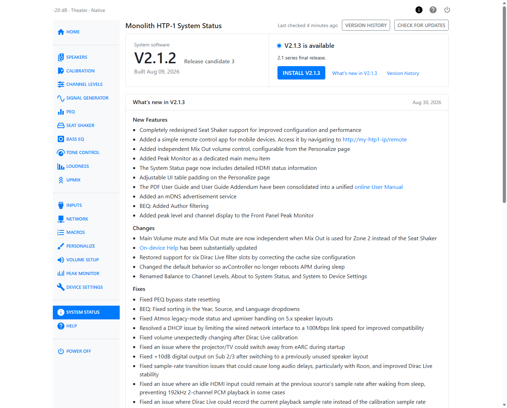
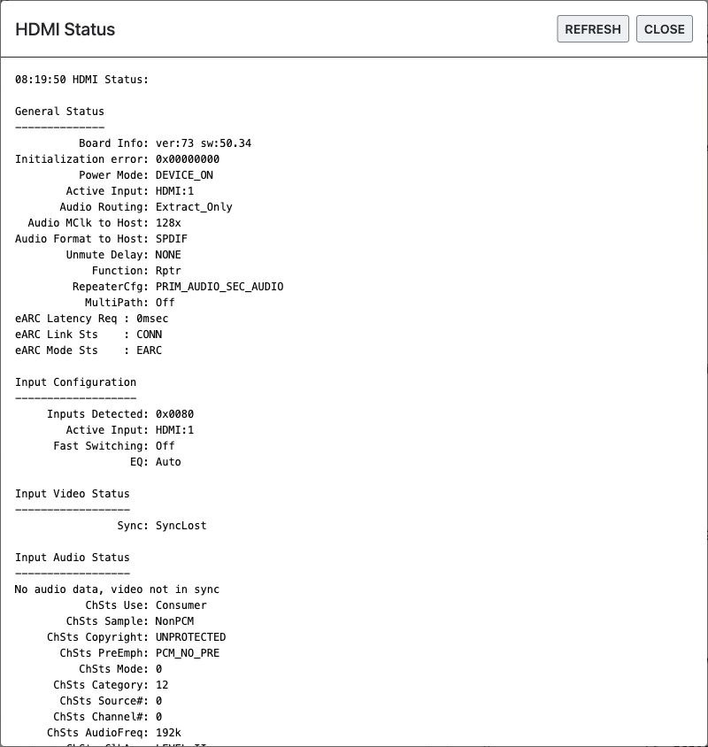

# System Status

The System Status page tells you what software the HTP-1 is running, whether an update is
available, and the current state of its network and HDMI connections. It also lists the exact
hardware and software versions that support will ask for if you report a problem.

## Software Version and Updates

The System Status page identifies the installed firmware and shows whether a newer public release
is available.

Click **Check for updates** to refresh the available release information.

When a new release is available, the page offers an installation button and information about what
has changed.

Select **Version history** to browse previous releases, read their release notes, or install a
different version. It identifies the installed release and newer versions, lets you show release
candidates/betas and older entries, and offers **Reinstall** for the current release. The same page
is available in standby through **View version history and install updates**. See
[Version History](maintenance.md#version-history) for the controls, installation consequences and
older-version precautions.

If the release server cannot be reached, System Status displays a warning rather than reporting
that the software is up to date. See [Updates and Support](maintenance.md) for the full update
procedure.

## Connection

| Field | What it shows |
| --- | --- |
| IP address | The IP address currently assigned to the HTP-1 on your network. |
| Web UI address | The local address for opening the HTP-1 Web UI in a browser. |
| mDNS hostname | The HTP-1’s unique hostname used for mDNS/Bonjour discovery so applications can identify and connect to this specific unit on the local network. |
| Decoder sample rate | The sample rate of the incoming audio, after decoding. |
| Encoder sample rate | The sample rate of the audio being sent to the speaker outputs. |
| Video | The current video resolution, color space, chroma subsampling, HDR status, bit depth, and 3D status for video received through an HTP-1 HDMI input. No video details are shown when ARC/eARC is used. |
| TV sound source | Where the audio driving the TV input is coming from, for example `eARC`. |
| eARC link | The state of the eARC connection to your TV. |
| CEC | The state of CEC (Consumer Electronics Control) communication with your TV and other HDMI devices. |

These last two fields report a short internal status string rather than a friendly sentence.
Support may ask you to read one of them aloud, or you can copy it exactly when writing in for
help. See [Reference](reference.md) for a glossary of the terms that appear in them.

## Community Discussion

Under **Discussion** in the **Web UI** panel of the System Status page, the
[AVS Forum HTP-1 owners thread](https://www.avsforum.com/threads/the-official-monoprice-monolith-htp-1-owners-thread.3112176/)
links to the community conversation about setup, troubleshooting, and new features. The same
panel shows when the Web UI was last updated, who maintains it, and its original author.

## Software and Hardware Versions

The **Hardware and firmware** panel lists the version numbers that identify your unit. The
installed system software version is shown at the top of the page.

| Field | What it is |
| --- | --- |
| avController | The version of the component that manages audio control and device state. |
| APM module | The version of the audio processing module. |
| HDMI module | The version of the HDMI receiver/transmitter firmware. |
| Backplane | The version running on the internal communication hub. |
| Hardware | The hardware revision of the backplane, MIO board, and DAC. |
| Serial number | Your unit's serial number. |
| rootfs | The base Linux filesystem image version. |
| System build | The commit and date of the installed system software build. |
| Commit | The short commit identifier of the installed software. |

!!! tip
    If you contact support, include the System software version shown at the top of the page and
    the avController, APM module, and Serial number values from this table. They let the
    development team match your report to the exact build you are running.

## HDMI Status

Click **HDMI status** in the **Connection** panel to open a detailed dump of the current HDMI
connection — useful when troubleshooting handshake, ARC/eARC, or CEC problems with your TV or other
HDMI devices. Click **Refresh** inside the dialog to pull a new reading without closing it.

